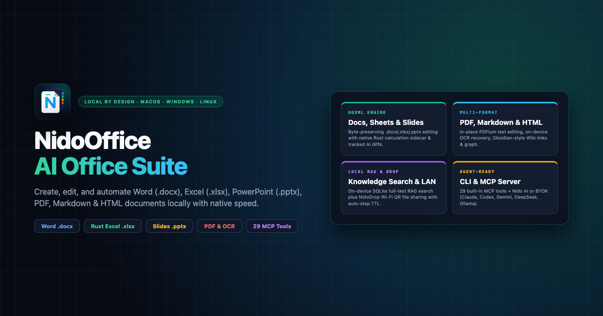

  

<h1 align="center">NidoOffice</h1>

<b>macOS, Windows 10/11 및 Linux용 로컬 퍼스트 AI 오피스 스위트</b>

  
  
  
  

  🌐 <a href="../../README.md">English</a> · <a href="README.vi.md">Tiếng Việt</a> · <a href="README.zh-CN.md">简体中文</a> · <a href="README.zh-TW.md">繁體中文</a> · <a href="README.ja.md">日本語</a> · <b>한국어</b> · <a href="README.es.md">Español</a> · <a href="README.fr.md">Français</a> · <a href="README.de.md">Deutsch</a> · <a href="README.pt-BR.md">Português (Brasil)</a> · <a href="README.ru.md">Русский</a>

**NidoOffice**는 **Word(`.docx`), Excel(`.xlsx`), PowerPoint(`.pptx`), PDF(온디바이스 OCR 포함), Markdown(`.md`), HTML**을 기본 지원하는 로컬 중심 데스크톱 AI 오피스 제품군입니다.

---

## 📦 최신 버전 직접 다운로드 (Evergreen 링크)

| 플랫폼 / OS | 아키텍처 | 직접 다운로드 | 비고 |
| :--- | :--- | :--- | :--- |
| **macOS (Apple Silicon)** | `arm64` (M1 / M2 / M3 / M4) | [**NidoOffice-mac-arm64.dmg**](https://github.com/stevedat/nidooffice-releases/releases/latest/download/NidoOffice-mac-arm64.dmg) | 코드 서명 및 Apple 공증 완료 (`.dmg`) |
| **macOS (Intel)** | `x64` | [**NidoOffice-mac-x64.dmg**](https://github.com/stevedat/nidooffice-releases/releases/latest/download/NidoOffice-mac-x64.dmg) | 코드 서명 및 Apple 공증 완료 (`.dmg`) |
| **Windows 10 / 11** | `x64` (64-bit) | [**NidoOffice-win-x64.exe**](https://github.com/stevedat/nidooffice-releases/releases/latest/download/NidoOffice-win-x64.exe) | 표준 NSIS 설치 파일 (`.exe`) |
| **Windows 10 / 11 (포터블)** | `x64` | [**NidoOffice-win-x64-portable.zip**](https://github.com/stevedat/nidooffice-releases/releases/latest/download/NidoOffice-win-x64-portable.zip) | 무설치 포터블 버전 (`.zip`) |
| **Windows 11 on ARM** | `arm64` | [**NidoOffice-win-arm64.exe**](https://github.com/stevedat/nidooffice-releases/releases/latest/download/NidoOffice-win-arm64.exe) | 네이티브 ARM64 설치 파일 (`.exe`) |
| **Microsoft Store** | `x64` & `arm64` | [**Microsoft Store — NidoOffice**](https://apps.microsoft.com/detail/9PDPX3W5J6D3) | Microsoft Store 자동 업데이트 |
| **Linux** | `arm64` | [**NidoOffice-linux-arm64.AppImage**](https://github.com/stevedat/nidooffice-releases/releases/latest/download/NidoOffice-linux-arm64.AppImage) | `AppImage` 실행 파일 |

---

## 🌐 앱 인터페이스 언어 변경 방법 (22개 언어 지원)

1. **NidoOffice** 실행 후 왼쪽 하단의 **설정(`⚙️` / Settings)** 아이콘을 클릭합니다 (단축키 `Cmd + ,` / `Ctrl + ,`).
2. **일반(General)** 탭에서 **언어(Language)** 항목을 찾습니다.
3. **한국어** 또는 원하는 언어를 선택하면 재시작 없이 즉시 적용됩니다.
